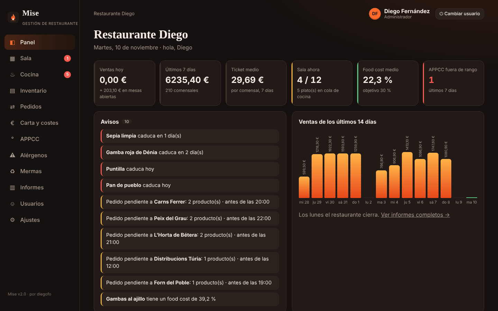
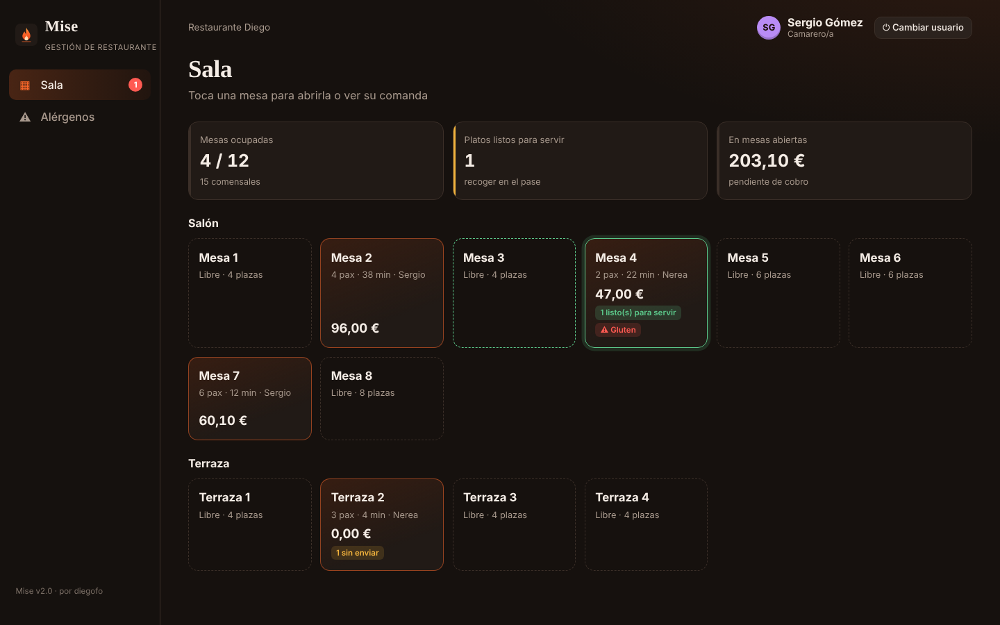
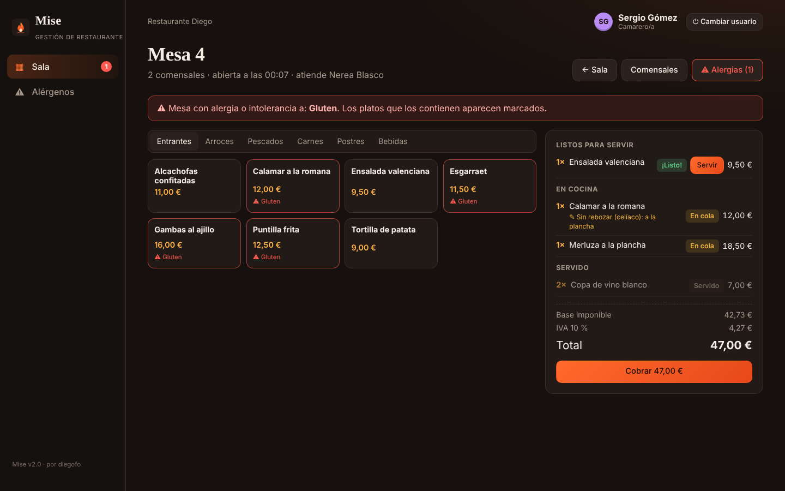
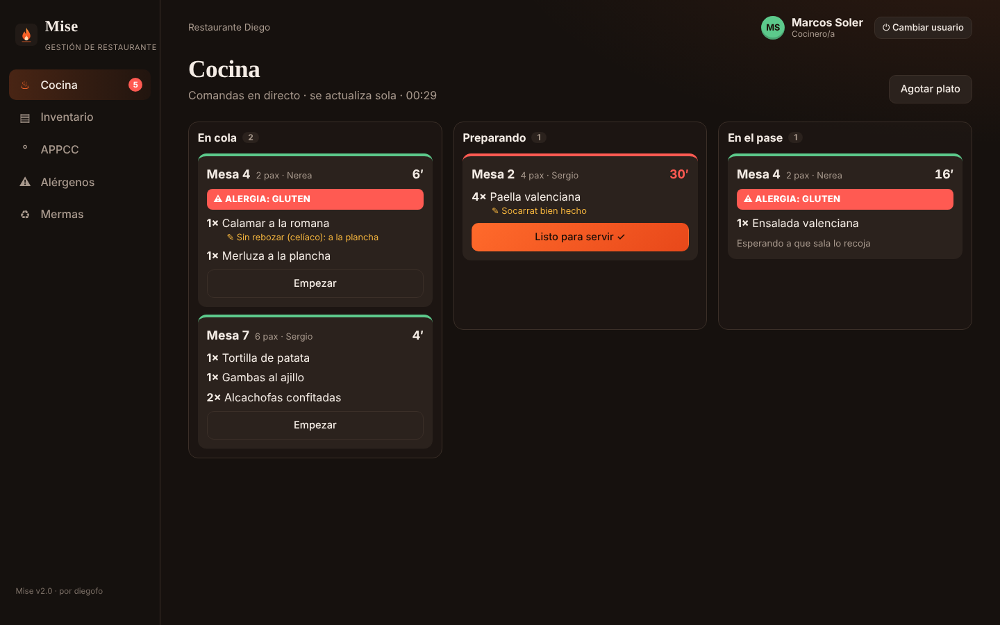
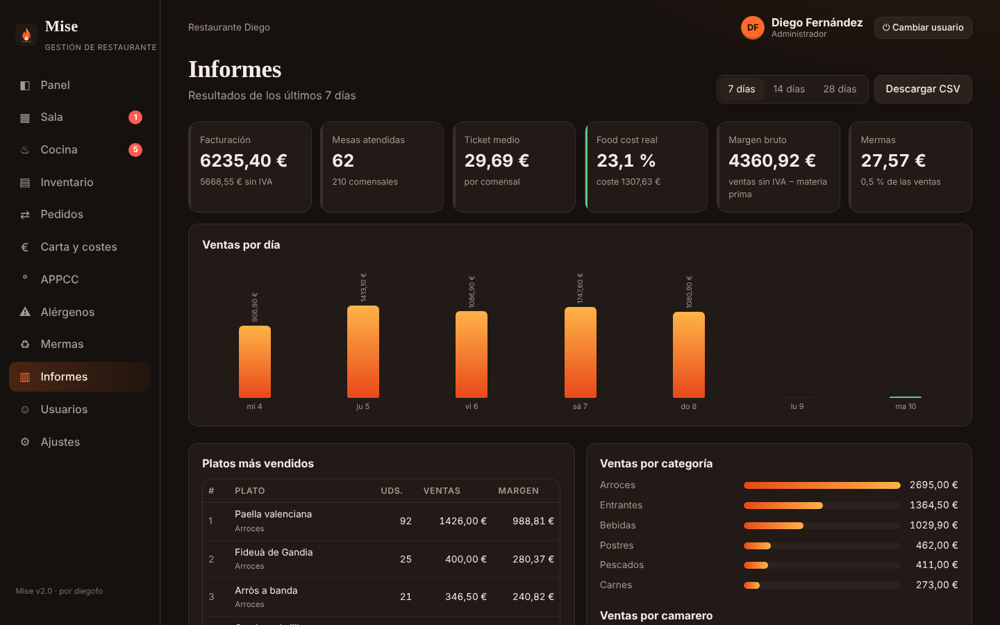
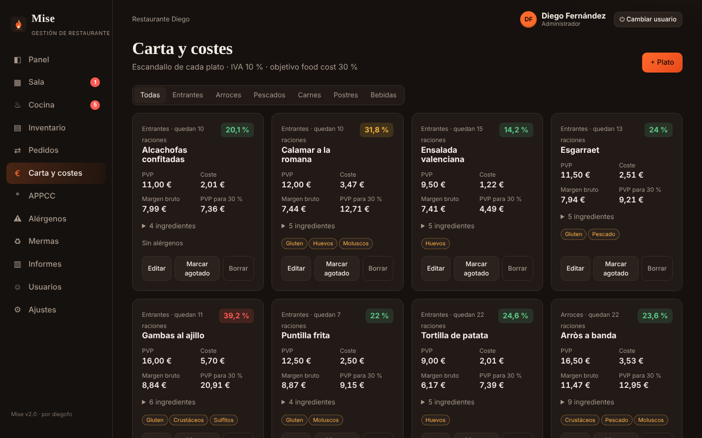
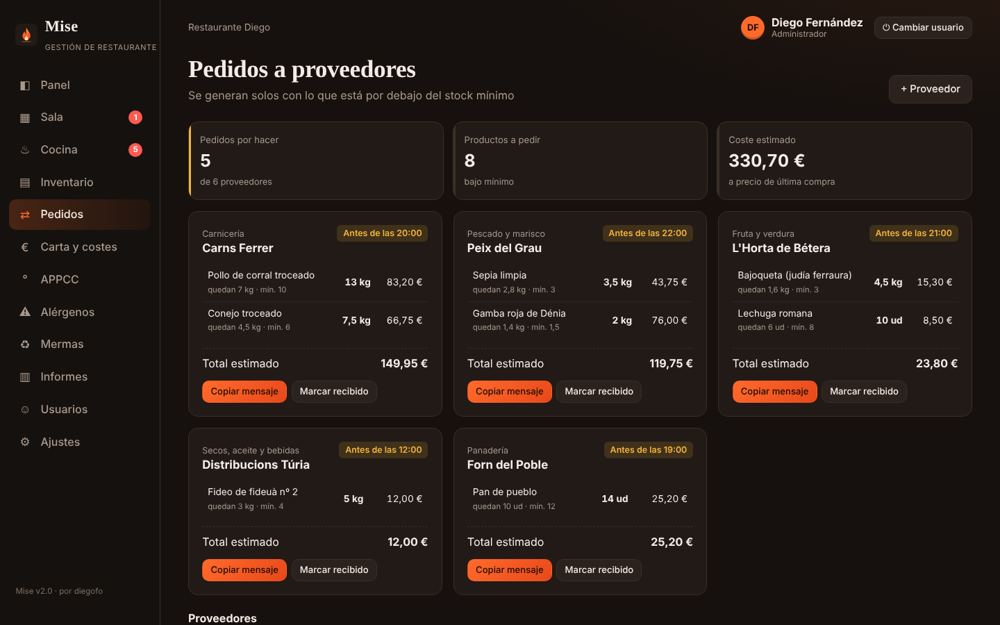
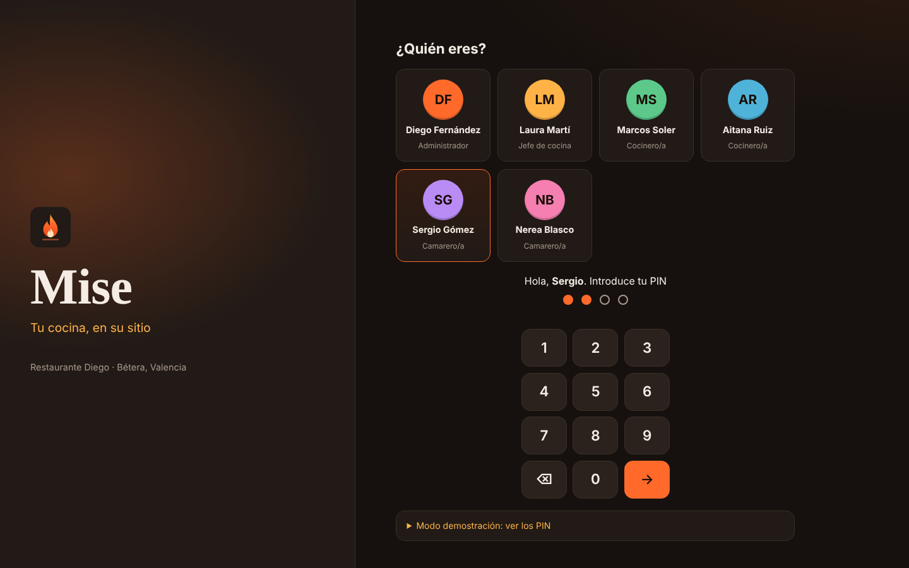
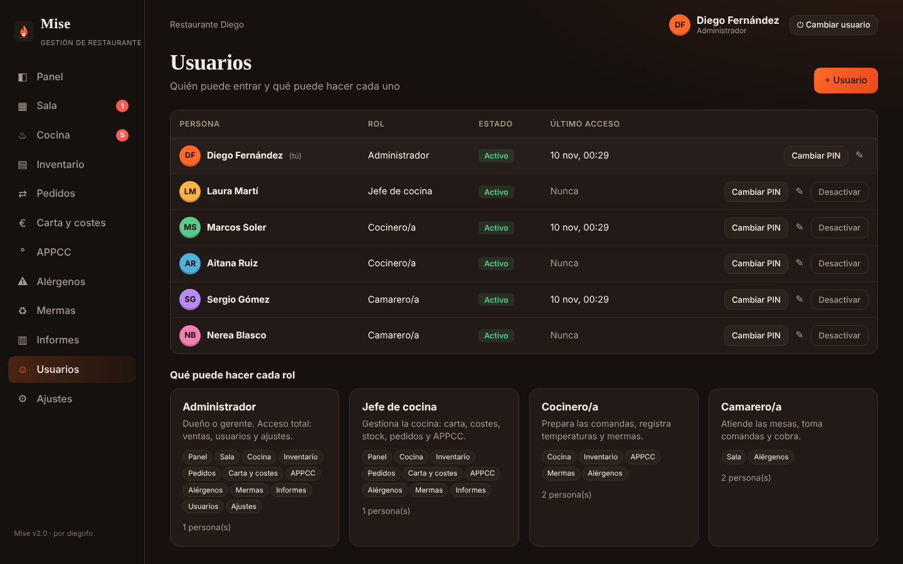
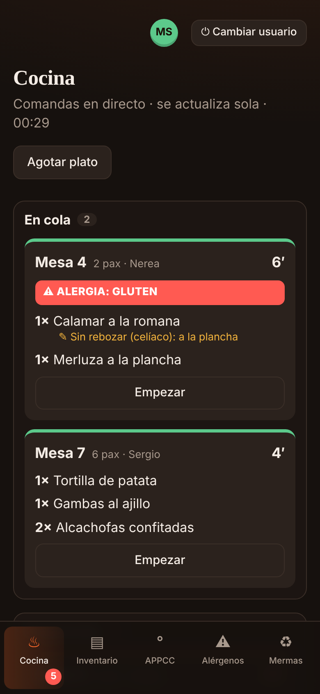

# 🔥 Mise · Tu cocina, en su sitio

**Software de gestión para restaurantes pequeños.** Sala y comandas, pantalla de cocina, inventario, pedidos a proveedores, escandallos, APPCC, alérgenos, mermas e informes de ventas. Un solo programa para todo el equipo, en el móvil, la tablet o el PC, incluso sin internet.



> **Demo con datos reales de ejemplo:** viene cargada con **Restaurante Diego**, un arrocero valenciano en Bétera: 24 platos, 48 ingredientes, 6 proveedores, 12 mesas, 6 personas en plantilla y **4 semanas de ventas** y registros.

---

## Probar la demo en 1 minuto

1. Abre `index.html` (o la versión publicada en GitHub Pages).
2. Elige a una persona y escribe su PIN:

| Persona | Rol | PIN | Qué ve |
|---|---|---|---|
| Diego Fernández | Administrador | `1111` | Todo: ventas, informes, usuarios y ajustes |
| Laura Martí | Jefa de cocina | `2222` | Cocina, carta y costes, stock, pedidos, APPCC, informes |
| Marcos Soler | Cocinero | `3333` | Pantalla de cocina, stock, APPCC, mermas |
| Aitana Ruiz | Cocinera | `4444` | Igual que Marcos |
| Sergio Gómez | Camarero | `5555` | Sala, comandas, cobro y alérgenos |
| Nerea Blasco | Camarera | `6666` | Igual que Sergio |

3. **El truco para enseñarla:** abre dos ventanas, una como **Sergio (camarero)** y otra como **Marcos (cocinero)**. Cuando Sergio envía una comanda, aparece al momento en la pantalla de cocina. Cuando Marcos la marca como lista, la mesa se ilumina en verde en la sala.

## Un servicio con Mise

```
 CAMARERO                        COCINA                         ADMINISTRADOR
 ─────────                       ──────                         ─────────────
 Abre la mesa 4 (2 pax,          
 alergia: gluten)          
 Pide paella y calamares  ──▶    Ticket "MESA 4 ⚠ GLUTEN"
 (el stock se descuenta)         Empezar → Listo  ──────┐
 La mesa se ilumina  ◀──────────────────────────────────┘
 Sirve y cobra con tarjeta ─────────────────────────────▶  Ventas, ticket medio,
                                                           food cost real, informes
```

## Funciones

### Sala (camareros)
- **Plano de mesas** por zonas (salón y terraza): libres, ocupadas, con platos listos o sin enviar.
- **Comanda táctil** por categorías, con cantidades y **notas para cocina** ("sin cebolla", "al punto").
- **Alergias de la mesa:** si un plato lleva ese alérgeno, avisa antes de pedirlo y cocina lo ve en rojo.
- **Platos agotados o sin stock** bloqueados automáticamente.
- Las **bebidas** van a barra y no pasan por cocina.
- **Cobro** con tarjeta, efectivo (calcula el cambio) o Bizum, con desglose de IVA.

### Cocina (KDS)
- **Pantalla de comandas en directo**: en cola → preparando → en el pase.
- Tiempo de espera de cada ticket en verde, ámbar o rojo.
- Avisos de **platos agotados** y de los que quedan pocas raciones.

### Gestión
- **Inventario** con caducidades, mínimos y proveedor. Se descuenta solo con cada venta.
- **Pedidos**: lista de compra por proveedor, mensaje listo para WhatsApp y entrada de stock al recibir.
- **Carta y costes (escandallos)**: coste, *food cost*, margen y precio recomendado de cada plato.
- **APPCC**: temperaturas por cámara y turno, acción correctora obligatoria y exportación a CSV.
- **Carta de alérgenos** imprimible, generada a partir de los ingredientes.
- **Mermas** según la jerarquía de la Ley 1/2025 de desperdicio alimentario.

### Administración
- **Informes**: facturación, ticket medio, food cost real, margen, platos más vendidos, ventas por día, categoría, camarero y forma de pago. Exportación a CSV.
- **Usuarios y roles**: alta de personal, cambio de PIN, activar o desactivar.
- **Ajustes**: datos fiscales, IVA, food cost objetivo, bloqueo automático y copias de seguridad.

<p>
  
  
</p>
<p>
  
  
</p>
<p>
  
  
</p>
<p>
  
  
</p>
<p align="center"></p>

## Seguridad

- **Acceso con PIN de 4 cifras** por persona, como en un TPV de hostelería.
- Los PIN **no se guardan**: se guarda su *hash* SHA-256 con una "sal" aleatoria distinta para cada usuario.
- **5 intentos fallidos** bloquean el acceso durante 30 segundos.
- **Bloqueo automático** tras unos minutos sin uso (configurable), pensado para tablets compartidas.
- **Permisos por rol** comprobados en cada pantalla y en cada botón. Por ejemplo, un camarero no ve costes y un cocinero no puede firmar registros por otra persona.
- Todo el texto que escriben los usuarios se *escapa* antes de mostrarse (protección XSS).
- Siempre queda al menos un administrador activo.

> Esta versión guarda los datos en el propio dispositivo. Para varios dispositivos a la vez, la siguiente fase añade un servidor con base de datos y autenticación (ver *Próximos pasos*).

## Tecnología

- **HTML, CSS y JavaScript** sin frameworks ni dependencias: carga al instante en cualquier tablet.
- **PWA** instalable que funciona sin conexión (*service worker* que primero intenta la red).
- **localStorage** como base de datos local, con sincronización en directo entre pestañas.
- **Diseño adaptable**: barra lateral en escritorio, barra inferior en el móvil y vista de impresión para la carta de alérgenos.

```
├── index.html            Estructura de la página
├── manifest.webmanifest  Datos para instalar la app
├── sw.js                 Service worker (modo sin conexión)
├── css/estilos.css       Estilos
├── js/
│   ├── sha256.js         Hash de los PIN
│   ├── datos.js          Datos y demo de Restaurante Diego (incluido el historial de ventas)
│   ├── calculos.js       Lógica de negocio: costes, stock, ventas, pedidos
│   ├── ui.js             Utilidades de interfaz: formularios, tarjetas, gráficos
│   ├── auth.js           Usuarios, roles, permisos y pantalla de acceso
│   ├── vistas-sala.js    Sala, comandas y pantalla de cocina
│   ├── vistas-cocina.js  Inventario, pedidos, carta, APPCC, alérgenos, mermas
│   ├── vistas-admin.js   Panel, informes, usuarios y ajustes
│   └── app.js            Navegación, permisos de cada botón y refresco en directo
└── docs/
    ├── RA1-memoria.md    Memoria del RA1 (análisis del sector)
    └── capturas/
```

## Cómo ejecutarla

- **Rápido:** doble clic en `index.html`.
- **Completo (instalable y sin conexión):** sírvela desde un servidor local, por ejemplo con *Live Server* de VS Code o con `python -m http.server 8000`, y abre `http://localhost:8000`.
- **Publicarla:** súbela a GitHub y activa *Settings → Pages*.

## Próximos pasos

- Servidor con API y base de datos para sincronizar tablets y móviles en tiempo real.
- Impresión de tickets y comandas en impresora térmica de cocina.
- Envío directo de pedidos a proveedores.
- Reservas de mesas.
- Integración con datáfono y con el sistema Verifactu de la AEAT.

## Licencia

MIT © Diego Fernández Ortega
